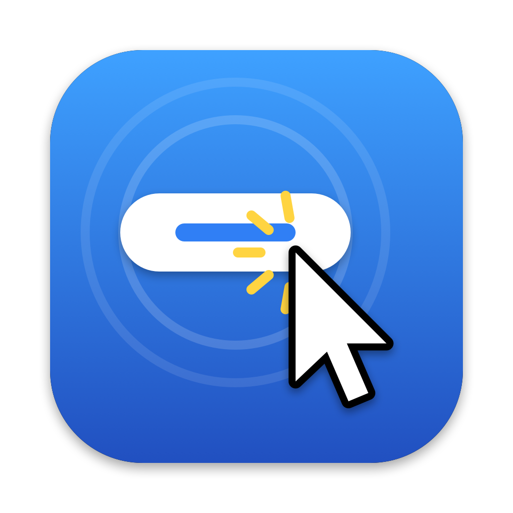

# Autoclick

A small macOS app that watches part of your screen for a button and clicks it every time it shows up.

It is built for repetitive web workflows where you approve, confirm or advance one item at a time, the page takes a few seconds to load the next item, and the same button appears again in the same place. It works with any app, including managed browsers where extensions are not allowed, because it only looks at pixels and posts ordinary mouse clicks.

**[Download the latest Autoclick.zip](https://github.com/daubman/autoclick/releases/latest/download/Autoclick.zip)** - macOS 14 or later, Apple silicon or Intel.

## How it works

1. You drag a box around the area of the screen to watch.
2. Autoclick shows you a snapshot of that area, and you draw a box around the button.
3. When you press Start, it checks the area twice a second. When it sees the button it waits a moment for the page to settle, clicks the center of the button, then waits for the button to disappear before looking for the next one.
4. If the button is still showing after 15 seconds, it assumes the click was missed and clicks again.
5. It stops after 50 clicks, when you press Stop, or when you move the mouse into the top-left corner of the main screen.

Matching is a plain grayscale image comparison, so it handles Retina and non-Retina displays, multiple displays, and small rendering differences such as a hover tint.

## Install

1. Download [Autoclick.zip](https://github.com/daubman/autoclick/releases/latest/download/Autoclick.zip) and double-click it to unzip.
2. Move **Autoclick.app** to your Applications folder.
3. Open it. The app is not notarized by Apple, so the first time macOS will refuse to open it:
   - Open **System Settings > Privacy & Security**, scroll down, and click **Open Anyway** next to the Autoclick message. Then open the app again and confirm.
   - Or, in Terminal: `xattr -dr com.apple.quarantine /Applications/Autoclick.app`

## Set up

The app window walks you through three steps.

**1. Permissions.** Autoclick needs two macOS permissions, both under System Settings > Privacy & Security:

| Permission | Why |
|---|---|
| Screen Recording | To see whether the button is on screen. Images stay on your Mac. |
| Accessibility | To move the mouse and click. |

Click each **Grant…** button and turn on Autoclick in the list that opens. macOS only applies Screen Recording after the app restarts, so click **Relaunch** afterwards. Both rows should show a green check.

On a managed Mac, your IT policy may block one of these permissions. If the switch is grayed out, Autoclick cannot work on that machine.

**2. What to click.** Get the page showing the button you want clicked, then:

1. Click **Capture Region & Target…**. The screen dims.
2. Drag a box around the area where the button appears. Make it a little larger than the button, in case the button shifts slightly between items, but keep it small: a smaller area is faster to search.
3. A window shows a snapshot of that area. Drag a tight box just inside the edges of the button, so it holds the button and its label and none of the surrounding text that changes from item to item. Click **Use This Target**.
4. Autoclick tests the match straight away and prints the score in the log. **Test** repeats the check at any time.

**3. Run.** Click **Start**. The Autoclick window floats above other windows so Stop is always within reach. Each click is logged with its time and position.

## Settings

Open **Settings…** from the window or press ⌘, to change these:

| Setting | Default | What it does |
|---|---|---|
| Max clicks | 50 | Stop after this many clicks. |
| Check every | 0.5 s | How often to look for the button. |
| Settle delay | 0.4 s | Pause after the button appears before clicking. |
| Click again after | 15 s | If the button is still there this long after a click, click it again. Raise this if items take longer to process. |
| Match tolerance | 18 | Mean pixel difference allowed, from 0 to 255. Lower is stricter. |
| Bring the target's app to the front | On | Browsers ignore clicks on background windows, so Autoclick activates the window under the button first. |
| Put the mouse back | On | Returns the pointer to where it was after each click. |

## Tips and troubleshooting

- **Do not move or scroll the watched window while it runs.** The region is a fixed spot on the screen. If the window moves, capture again.
- **Clicks are logged but nothing happens.** Check that Accessibility shows a green check and that "Bring the target's app to the front" is on. Clicking once into the target window before pressing Start can also help.
- **Test says NOT found while the button is visible.** Capture again with a tighter box around the button. If the score is only a little above the tolerance, raise the tolerance slightly.
- **It clicks the wrong thing.** Lower the tolerance, or pick a box that includes the button's label so it cannot match a plain area of the same color.
- **Permissions show a red X after an update.** macOS ties permissions to the app's signature, and each build has a new one. Remove Autoclick from both permission lists, add it again, and click Relaunch.
- **A dialog appears after some clicks.** Autoclick only clicks the one target. It waits, logging "Still waiting" every 30 seconds, until you deal with the dialog.
- A log of every session is kept at `~/Library/Application Support/Autoclick/autoclick.log`.

Use it responsibly. Autoclick clicks whatever matches, so check that the action you are automating is one you would have taken by hand for every item.

## Build from source

You need Xcode 15 or later (or the matching Command Line Tools) on macOS 14 or later.

```sh
git clone https://github.com/daubman/autoclick.git
cd autoclick
swift test                # run the unit tests
scripts/build-app.sh      # builds build/Autoclick.app and build/Autoclick.zip
open build/Autoclick.app
```

`scripts/build-app.sh` builds a universal binary, wraps it in an app bundle, signs it ad hoc and zips it. Set `CODESIGN_IDENTITY` to a Developer ID certificate name to sign it properly.

### Layout

| Path | Contents |
|---|---|
| `Sources/AutoclickCore` | Template matching, coordinate conversions and the click loop. No AppKit, fully unit tested. |
| `Sources/Autoclick` | The app: windows, region and target pickers, settings, screen capture, permissions and mouse events. |
| `Tests/AutoclickCoreTests` | Tests for matching, geometry, and the click loop against a simulated screen. |
| `scripts/build-app.sh` | Builds and packages the app. |
| `scripts/make-icon.swift` | Draws the app icon into `Resources/`. Run it after changing the design. |
| `.github/workflows` | CI on every push and pull request; release on every `v*` tag. |

### Releasing

CI runs the tests and builds the app on every push and pull request, and attaches the zip to the run. To publish a download, tag a version:

```sh
git tag v1.0.0
git push origin v1.0.0
```

The release workflow tests, builds, and publishes a GitHub release with `Autoclick.zip` attached. The download link at the top of this file always points at the newest release.

## License

[MIT](LICENSE)
